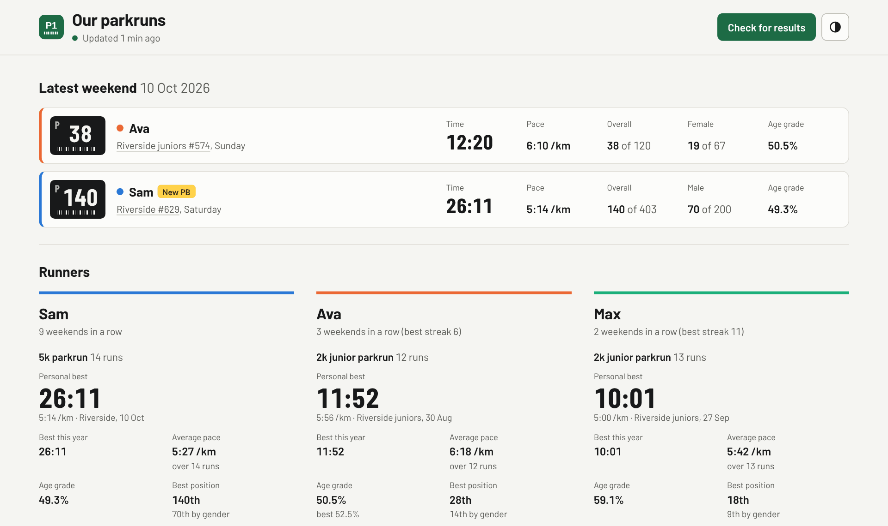
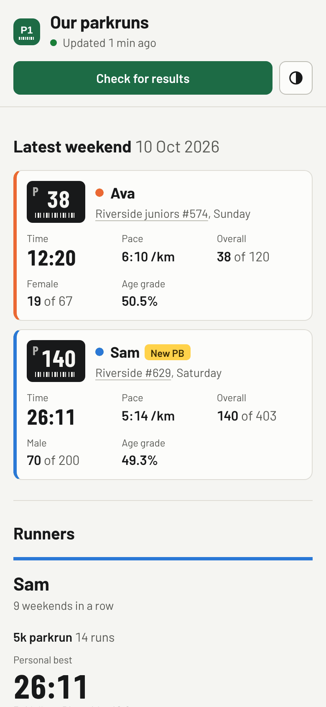

# parkrun family dashboard

<picture>
  <source media="(prefers-color-scheme: dark)" srcset="docs/screenshots/desktop-dark.png">
  
</picture>

A small self-hosted web app that shows a family's parkrun results in one place: the latest weekend, personal bests, trends, run counts, streaks and milestones, for 5k parkrun and 2k junior parkrun. It checks parkrun automatically at weekends, emails you when new results land, and runs as a single Docker container.

parkrun has no public API, so the app reads each runner's public results page (`/parkrunner/<id>/all/`) and, for gender position, the event's results page. It does this politely: a few requests per check, a pause of a few seconds between each, and only at weekends.

## What it does

| | |
|---|---|
| Latest weekend | Each runner's most recent result as a finish token: time, overall and gender position (with field sizes), age grade, PB and milestone badges |
| Runners | Per person and distance: PB, best this year, age grade, best positions, best at each event, weekend streak, and progress to the next milestone |
| Times over time | One chart per distance (2k junior / 5k), everyone with results on the same chart; table view; PNG and SVG download |
| All results | Combined feed, newest first; table on desktop, cards on a phone |
| Downloads | Excel, CSV and JSON of every result (filter with `?runner=Name&distance=2k`) |
| Email | One email per check that finds new results, with the results and a link to the dashboard. A warning email if checks keep failing |
| Automatic checks | Saturdays and Sundays at 11:00, 12:30, 14:00, 17:00 and 21:00; stops for the day once everyone expected has a result. Monday-morning catch-up for corrected results |
| Manual check | The **Check for results** button (limited to once every 5 minutes) |
| Gaps | Every check re-reads full histories, so anything missed while the container was down is filled in next time |
| Light and dark | Follows the device, with a toggle |
| Home Assistant | `GET /api/latest` and `GET /api/summary` (JSON) |

Milestones: junior parkrun 11 (half marathon), 21 (marathon), 50 (ultra marathon), 100, 250; 5k parkrun 25, 50, 100, 250, 500, 1000, plus 10 for juniors. Junior and 5k runs are counted separately, as parkrun does.

## On a phone

<picture>
  <source media="(prefers-color-scheme: dark)" srcset="docs/screenshots/phone-dark.png">
  
</picture>

The screenshots show made-up runners from `scripts/demo_data.py`. They follow your GitHub theme, light or dark, like the app itself.

## Why

Three runners, two distances and several parkrun events meant checking separate parkrun pages every weekend to see how everyone did. This puts the whole family's results, PBs and milestones in one place and emails when new results land. It follows my shared app standard (see [How this was built](#how-this-was-built)).

## Set up (Docker)

You need Docker.

1. **Create folders and config.**
   ```bash
   sudo mkdir -p /opt/appdata/parkrun/{data,config}
   sudo chown -R 1003:1006 /opt/appdata/parkrun   # PUID:PGID from .env
   sudo mkdir -p /srv/parkrun && cd /srv/parkrun   # docker-compose.yml and .env live here
   # copy docker-compose.yml, .env.example and config/runners.example.yaml from this repo, then:
   cp .env.example .env            # fill in BASE_URL and the SMTP settings
   sudo cp config/runners.example.yaml /opt/appdata/parkrun/config/runners.yaml   # add your runners
   ```
2. **Start it.**
   ```bash
   docker compose up -d
   docker compose logs -f parkrun
   ```
   Open `http://<server>:5062`. On first start it loads every runner's history straight away (this takes about a minute because of the pauses between requests).

Or in Portainer: *Stacks → Add stack*, paste `docker-compose.yml`, and add the `.env` values under *Environment variables*.

### Updating

```bash
cd /srv/parkrun && docker compose pull && docker compose up -d
```
The database lives in `/opt/appdata/parkrun/data`, so updates and restarts keep all data.

### Access

Port 5062 on your LAN. For access away from home, use Tailscale to reach the server's Tailscale address on the same port, and set `BASE_URL` to whichever address you want email links to use. The app has no login, so don't expose it to the internet.

## Configuration

**Runners** go in `runners.yaml` (see [config/runners.example.yaml](config/runners.example.yaml)). Restart the container after editing. Removing someone hides them; their results stay in the database.

**Settings** are environment variables (see [.env.example](.env.example)):

| Variable | Default | |
|---|---|---|
| `BASE_URL` | `http://localhost:8000` | Address used in email links |
| `SMTP_HOST`, `SMTP_PORT`, `SMTP_USER`, `SMTP_PASSWORD` | | Your SMTP relay. Email is off when `SMTP_HOST` is empty |
| `SMTP_STARTTLS` / `SMTP_SSL` | `false` | Encryption for the relay connection |
| `EMAIL_FROM`, `EMAIL_TO` | | Sender, and comma-separated recipients |
| `POLL_DAYS`, `POLL_TIMES` | `saturday,sunday` / `11:00,12:30,14:00,17:00,21:00` | Automatic checks (local time) |
| `CATCHUP` | `monday 08:30` | Weekly re-check for corrected results |
| `FETCHER` | `http` | `http`, `browser` (use the `:browser` image, which sets it for you) or `manual` |
| `REQUEST_DELAY` | `3-6` | Random pause between requests, seconds |
| `REFRESH_COOLDOWN` | `300` | Seconds between manual checks |
| `FAILURE_ALERT_THRESHOLD` | `3` | Failed checks in a row before a warning email |
| `TZ` | `Europe/London` | |
| `PUID`, `PGID` | `1003`, `1006` | The user and group the container runs as (same as my other containers). `/opt/appdata/parkrun` must belong to them |
| `LOGO_SCALE` | `1` | Size tweak for the header wordmark |

Use **Send a test email** on the dashboard to check the SMTP settings.

### Your own logo and icon

Put image files next to `runners.yaml` (the `/config` folder) and restart the container:

- `logo.png` (or `.svg`/`.webp`): shown in the header as "Our" followed by the logo. The app turns it into a cut-out painted in the page's text colour (so it follows light/dark mode), trims the empty space, and sizes it so the logo's lowercase letters match the height of "Our" and sit on the same baseline. A dark logo on a plain background works best. If it looks too big or small, set `LOGO_SCALE` (e.g. `1.2` or `0.9`) in `.env`. Without a logo the header reads "Our parkruns".
- `icon.png` or `icon.jpg` (or `.svg`/`.ico`): the square logo at the top left of the header **and** the browser-tab and home-screen icon (my [app standard](#how-this-was-built) uses one image for both). PNG/JPG icons are trimmed to a small margin, made square, and served at 32, 180, 192 and 512 px; thin line art is thickened at 32 px so it stays visible in a browser tab. Without it the built-in icon (`app/static/icon.svg`, a green finish token) is used for both. To match my other apps, use a rounded square in the accent green `#1d6b45` with a simple white symbol.

The repo doesn't include any third-party logos; supply your own files.

### If parkrun blocks requests

parkrun's firewall refuses some automated requests (for example from cloud servers). From a home connection, plain requests normally work. If checks start failing with "parkrun refused the request":

1. Switch to the headless-browser image: set `image: ghcr.io/nick-a-louse/parkrun-family-dashboard:browser` and `FETCHER=browser`, then `docker compose up -d`.
2. Or import pages by hand: open a runner's results page in your browser, save it (*Save page as… → Web page, HTML only*), and upload it under **Import a saved page**. Event results pages can be imported the same way to fill in gender positions.

## Monitoring

`GET /healthz` returns `{"ok": true, "version": ...}` while the database answers; the Docker healthcheck uses it, so `docker compose ps` shows `healthy`.

### Grafana (optional)

The app publishes Prometheus-format metrics at `/metrics` (`up`, last successful check, failed checks in a row, results per runner, next scheduled check). To have VictoriaMetrics scrape it and Grafana alert on it:

1. **Join the monitoring network.** Add to `docker-compose.yml` (use your VictoriaMetrics network's name, from `docker inspect victoriametrics -f '{{range $k, $v := .NetworkSettings.Networks}}{{$k}}{{end}}'`):
   ```yaml
   services:
     parkrun:
       networks: [default, monitoring]
   networks:
     monitoring:
       external: true
       name: grafana_grafana_default   # your network's name
   ```
2. **Scrape it.** Add to VictoriaMetrics' `scrape.yaml` under `scrape_configs:`, then reload (`curl http://localhost:8428/-/reload`):
   ```yaml
     - job_name: parkrun
       scrape_interval: 60s
       static_configs:
         - targets: ["parkrun:8000"]
   ```
3. **Create the alerts and dashboard.** With Grafana on the same network:
   ```bash
   docker exec -e GRAFANA_PASSWORD='<admin password>' parkrun python -m app.grafana_setup
   ```
   This creates three alert rules in a "Parkrun" group beside your existing alerts, using your existing contact points: **Parkrun Dashboard Down** (not scrapeable for 5 minutes), **Parkrun Checks Failing** (3+ failed checks in a row) and **Parkrun Results Not Updating** (no successful check for 8 days). It also creates a "Parkrun dashboard" in Grafana. It's safe to run again; it updates in place. Use `--url` if Grafana isn't reachable as `http://grafana:3000`.

## Development

```bash
python -m venv .venv && . .venv/bin/activate
pip install -r requirements-dev.txt
python -m pytest

# try it with made-up data, no parkrun requests
python scripts/demo_data.py /tmp/demo.db
DB_PATH=/tmp/demo.db RUNNERS_FILE=config/runners.demo.yaml SCHEDULER_ENABLED=false \
  uvicorn app.asgi:app --reload
```

Test fixtures in `tests/fixtures` are anonymised copies of real parkrun page structures. Pushing to `main` runs the tests and publishes `:latest` and `:browser` images to ghcr.io.

## Files

```
docs/screenshots/             the pictures in this README (light and dark, desktop and phone)
.github/workflows/build.yml   tests, then builds :latest and :browser images to ghcr.io
Dockerfile, Dockerfile.browser
docker-compose.yml            what runs on the server (/srv/parkrun)
config/                       example runners.yaml files
scripts/demo_data.py          made-up data for trying the dashboard
tests/                        pytest, with anonymised parkrun page fixtures
app/
  parser.py     read parkrunner and event results pages
  fetcher.py    polite HTTP / headless-browser / manual fetchers
  sync.py       fetch, upsert, fill gaps, trigger emails
  stats.py      PBs, streaks, milestones, chart series
  scheduler.py  weekend checks and Monday catch-up
  notify.py     email
  exports.py    CSV / JSON / Excel
  main.py       web app and API
  branding.py   your logo and icon, sized for the header and every icon size
  metrics.py    /metrics for VictoriaMetrics
  static/       gomez-ui.css and gomez-ui.js (shared look, copied unchanged), app.css, app.js, fonts
```


Not affiliated with parkrun. Results are parkrun's; this only reads public pages for personal use.

## How this was built

This is one of several self-hosted apps I run at home. The code was written by Claude (an AI coding agent) under my direction. My part was the requirements, the standards, the review and the decisions:

- **Requirements first.** Functional and non-functional requirements were agreed as tickets in Obsidian before any code was written.
- **One shared standard.** All my apps share one look, one repo layout and one build-and-deploy pipeline (GitHub Actions → GitHub Container Registry → Docker Compose). `gomez-ui.css` and `gomez-ui.js` are the shared UI kit from that standard; gomez is my home server's name.
- **Reviewed before merging.** Every change came in as a pull request, with screenshots at desktop and phone widths in light and dark mode, and was merged only after I'd reviewed it and the tests passed.

More on how I work this way: [my GitHub profile](https://github.com/nick-a-louse).

## Licence

[MIT](LICENSE). Fonts are Barlow and Barlow Condensed under the SIL Open Font License (see the `OFL.txt` next to them).
